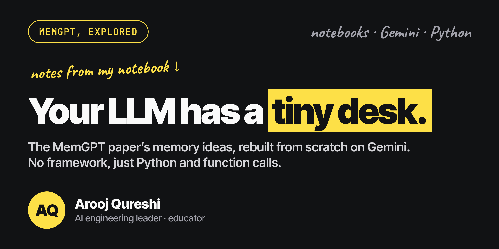
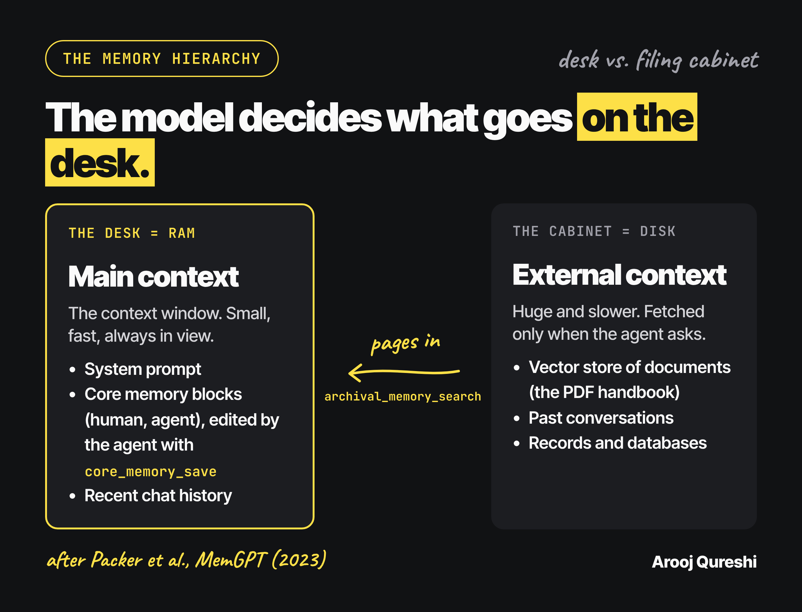

<p align="center">
  
</p>

`MEMGPT, EXPLORED` · `GEMINI` · `PYTHON` · `JUPYTER`

# Your LLM has a tiny desk

My LLM kept forgetting my name. So I gave it a filing cabinet.

Every LLM works at a small desk: its context window. Whatever isn't on the desk, it can't see. The [MemGPT paper](https://arxiv.org/abs/2310.08560) suggests a fix borrowed from operating systems: keep a small, fast working memory on the desk, a huge slow one in the cabinet, and **let the model decide what to move between them.**

These notebooks rebuild that idea from scratch on Gemini. No MemGPT or Letta framework, just Python, `google-generativeai` and function calling, so every moving part is visible.

> **The goal:** a stateful agent that adapts to what it learns, with a **selective memory** that only recalls what the reader is allowed to see.

---

## The idea in one picture

<p align="center">
  
</p>

| `THE DESK = RAM` | `THE CABINET = DISK` |
| --- | --- |
| **Main context.** The context window: system prompt, core memory, recent chat. Small, fast, always in view. | **External context.** A vector store, files, old conversations. Huge, slower, fetched only when the agent asks. |

---

## What's inside

| # | Notebook | What it shows |
| --- | --- | --- |
| 1 | [`1-Implementing_Editable_Memory_Gemini`](1-Implementing_Editable_Memory_Gemini.ipynb) | **Self-editing memory.** The agent saves facts to its own core memory with a `core_memory_save` tool call. |
| 2 | [`2-Building-Agents-with-Gemini`](2-Building-Agents-with-Gemini.ipynb) | **Memory blocks and agent state.** Reading its own state, plus a task queue the agent manages itself. |
| 3 | [`3-Agentic-RAG-Accessing_External_Memory_Gemini`](3-Agentic-RAG-Accessing_External_Memory_Gemini.ipynb) | **Agentic RAG.** The agent decides when to search a PDF handbook with `archival_memory_search`. |
| 4 | [`4-Orchestrating_agents_with_MemGPT_Gemini`](4-Orchestrating_agents_with_MemGPT_Gemini.ipynb) | **Multi-agent orchestration.** An evaluator agent and an outreach agent share memory to screen a résumé; a round-robin agent group. |
| 5 | [`5-all-memory-examples-in-one`](5-all-memory-examples-in-one.ipynb) | **Everything in one place.** The concepts above in a single notebook. |
| 6 | [`6-Memory_Redaction_by_Security_Level`](6-Memory_Redaction_by_Security_Level.ipynb) | **Memory redaction.** An admin agent sees the full document; a restricted agent gets a redacted copy. |

### Self-editing memory, in four lines

This is the real trace from notebook 1:

```text
user  › my name is bob.
tool  › core_memory_save(section="human", memory="My name is bob.")
user  › what is my name
agent › Your name is Bob.
```

### Agentic RAG

```text
user  › What is the vacation policy?
tool  › archival_memory_search(query="vacation policy")
agent › answers from the passages it retrieved from handbook.pdf
```

### Shared memory, with locks on the drawers

```text
+--------------------------+      +---------------------------+
|   Hiring manager agent   |      |   Junior analyst agent    |
|      (admin rights)      |      |    (restricted rights)    |
+--------------------------+      +---------------------------+
              |                                 ^
              v                                 |
   sees: "Jane Doe, 555-867-5309"     gets: "[REDACTED], [REDACTED]"
              |                                 |
              +------> Redaction controller ----+
```

---

## What I learned

**1. Memory is a design decision, not a buffer.** Once the model chooses what to save, you have to decide what it is *allowed* to save, who can read it, and when it forgets.

**2. Agentic RAG beats stuffing the prompt.** The agent only goes to the cabinet when the question needs it, which keeps the desk clear for the conversation.

**3. Regex isn't redaction.** *I'll admit it:* in notebook 6 my redactor read "Candidate Jane" as a full name, blacked it out, and let the surname walk right out the door:

```text
[REDACTED] Doe is a strong hire.
```

Pattern matching is fine for a demo. In production, use a real PII detection service and test it on messy, real-looking text, not tidy forms.

> Memory isn't a feature. **It's a governance call.**

---

## Run it yourself

```bash
git clone https://github.com/arooj1/agentic-ai-memory-management.git
cd agentic-ai-memory-management
pip install google-generativeai fpdf PyPDF2 numpy pandas jupyter

export GEMINI_API_KEY="your-key"   # read by helper.py, never committed
jupyter notebook
```

- The notebooks use `gemini-1.5-flash`. If it isn't available on your account, change `model_name` to a current Gemini Flash model.
- `helper.py` reads your key from the environment. Don't paste keys into it.
- Sample data is included: `handbook.pdf` (RAG), `resume.pdf` (orchestration and redaction), the persona files `tony_stark.txt` and `spongebob_squarepants.txt`, and `task_queue_system_prompt.txt`. All of it is synthetic.

---

## Taking it to production

The notebooks run locally. Here's how I'd map the same pattern onto Google Cloud. **This is a design sketch, not something built in this repo.**

| Building block | Role |
| --- | --- |
| **BigQuery** | The secure record store, with policy tags and row-level access control |
| **Cloud Storage** | Holds the vector index files |
| **Sensitive Data Protection** (formerly Cloud DLP) | Finds and de-identifies PII before anything reaches a restricted agent |
| **Cloud Run** | Hosts a "memory broker" service that enforces who can recall what |
| **Vertex AI** | Agent runtime, orchestration and foundation models |

---

## Visual notes

- [`documents/From LLMs to Operating Systems: The MemGPT Approach.pdf`](documents/From%20LLMs%20to%20Operating%20Systems:%20The%20MemGPT%20Approach.pdf) is a one-document overview of the concepts. It opens right here on GitHub.
- The infographics, [`3-memory.html`](documents/3-memory.html), [`4-agentic-RAG-memory.html`](documents/4-agentic-RAG-memory.html) and [`5-Orchestrating_agents.html`](documents/5-Orchestrating_agents.html), are web pages. GitHub shows their source, so download one and open it in your browser.

---

## Credits and references

- **The paper:** Packer, Wooders, Lin, Fang, Patil, Stoica and Gonzalez, [*MemGPT: Towards LLMs as Operating Systems*](https://arxiv.org/abs/2310.08560), UC Berkeley, 2023.
- **The official project:** [letta-ai/letta](https://github.com/letta-ai/letta), formerly MemGPT.
- **The course these labs adapt:** DeepLearning.AI, [*LLMs as Operating Systems: Agent Memory*](https://learn.deeplearning.ai/courses/llms-as-operating-systems-agent-memory).

The notebooks here are my own Gemini rebuild of those course labs, written to understand the ideas from the inside.

---

<sub>**Arooj Qureshi** · AI engineering leader · educator · [LinkedIn](https://www.linkedin.com/in/arooj-a-qureshi) · [aroojqureshi.com](https://aroojqureshi.com)</sub>

*What does your agent remember that it shouldn't?*
